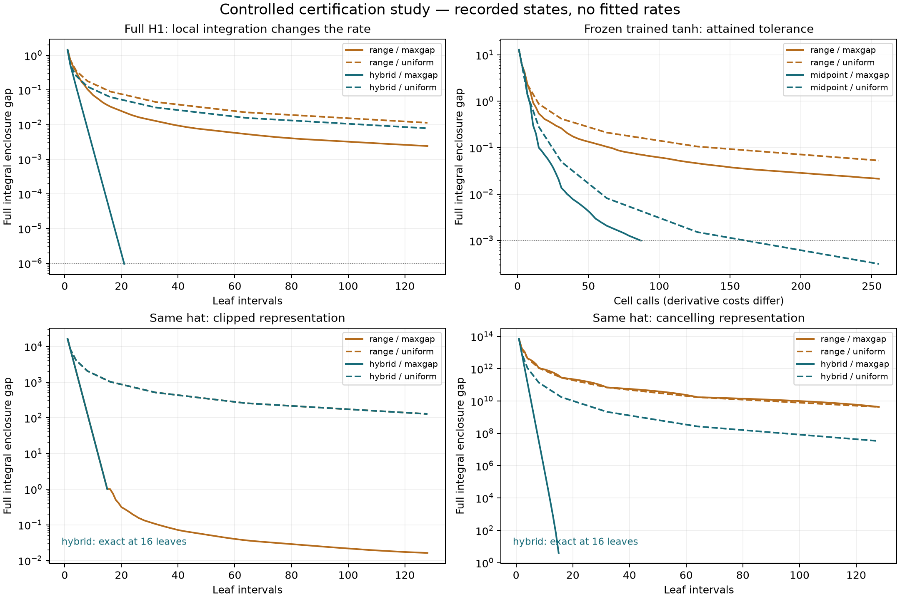

## Current manuscript status (31 October 2026)

The candidate material is now integrated into the manuscript. Statements below about an unchanged paper describe the earlier standalone research stage. Numerical records are unchanged. Public release is deferred at the author's request.

# Concrete originality work: completed research package

31 October 2026. The manuscript and its original experiments were not modified. This package contains standalone candidate theory, executed controlled experiments, exact records, independent checks, and a proposed route into a future revision.

## Recommendation

Build the paper around the interaction between **spatial adaptation, local integration, and the network representation**. Keep the existing Lipschitz benchmark, but add a precisely scoped structural separation and explain which computable oracle realizes it. Broadening the target list alone would be less informative.

The proposed new emphasis is:

> Certified affine-cell integration lets largest-gap refinement concentrate work near ReLU breakpoints; raw interval propagation can fail to exploit the same function because its enclosure depends on the network expression.

This is a candidate contribution, not an established claim of novelty or submission readiness.

## What was proposed and carried out

| Work item | Completed result |
|---|---|
| Extend the hinge example to a meaningful class | [Theorem A](THEORY.md): a fixed-size bounded class of rational ReLU splines with at most m breakpoints; exponential adaptive full-H1 gap upper bound and a first-order worst-case uniform gap |
| Make the growing-parameter board idea concrete | [Proposition B](THEORY.md): fixed architecture, O(N²) weights, squared-L2 integral exactly 1/3, adaptive O(1/N) gaps versus uniform gap N at budget N; explicit constants and diagonal quantifiers |
| Test varying local certification by element | Implemented exact rational polynomial integration on certified affine cells with directed-MPFR range fallback elsewhere |
| Isolate representation effects | Tested two algebraically equal normalized hats, one clipped and one expressed through cancelling ReLU terms |
| Turn the representation observation into a theorem | [Proposition C](THEORY.md): every N-cell partition has gap at least 16N⁴(1−N⁻²)³ for the raw cancelling graph, although the alternative graph represents the same function and admits the adaptive O(1/N) bound |
| Add actual tolerance successes | Executed 86 runs, including one- and three-hinge examples, clustered/dyadic controls, two precisions beyond the default, and two frozen trained/untrained tanh networks |
| Add an independent stronger local baseline | Implemented a validated midpoint rule with an interval second-derivative remainder for the actual tanh squared-value integrand |
| Audit the results | Independently expanded every ReLU network into affine pieces and checked all 6,012 terminal ReLU cell integrals; checked partitions and sums for all 86 runs; five targeted tests passed |
| Investigate tree-literature overlap | Checked Binev–DeVore Section 5 definitions and Theorem 5.2 in the author-uploaded full text; distinguished their modified indicator from raw maxgap |

## Main observed results

All gaps below are full **integral** enclosure widths, not rooted-norm widths. The raw exact endpoints and rooted-norm intervals are saved in the records. Values in this table are rounded observations, not outward-rounded certificates to reuse as endpoints.

| Case | Local rule / partition | Leaves at termination | Gap | Outcome |
|---|---|---:|---:|---|
| One hinge at 1/3, full H1 | Range / maxgap | 128 | 0.00240725 | Budget exhausted |
| Same | Affine-cell hybrid / maxgap | 21 | 9.53674e−7 | Requested 1e−6 reached |
| Same | Affine-cell hybrid / uniform | 128 | 0.00781255 | Budget exhausted |
| Three predefined hinges, full H1 | Affine-cell hybrid / maxgap | 60 | 7.71551e−7 | Requested 1e−6 reached |
| Same | Affine-cell hybrid / uniform | 128 | 0.0106659 | Budget exhausted |
| Normalized clipped hat, parameter N=128 | Range / maxgap | 128 | 0.0162430 | Budget exhausted |
| Same function and budget | Range / uniform | 128 | 128 | Budget exhausted |
| Equivalent cancelling hat, parameter N=128 | Range / maxgap | 128 | 4.29471e9 | Budget exhausted |
| Either hat representation, parameter N=128 | Affine-cell hybrid / maxgap | 16 | Exactly 0 | Exact rational integral 1/3 |
| Frozen trained tanh, squared L2 | Range / maxgap | 128 | 0.0214397 | Budget exhausted |
| Same | Midpoint / maxgap | 44 | 0.000997085 | Requested 1e−3 reached |
| Same | Midpoint / uniform | 128 | 0.000313679 | Requested 1e−3 reached |
| Frozen untrained tanh, squared L2 | Midpoint / either partition | 8 | 0.000532343 | Requested 1e−3 reached |

The trained and untrained tanh cases use the existing seed-0 checkpoints with no training or parameter mutation. The computed quantity here is squared L2, not the H1/H2 integrands of the older paired derivative study. There are only two checkpoints; this supports no population-level conclusion.

Uniform refinement checks only completed dyadic levels, so its first successful state may substantially overshoot the tolerance. The comparison is between the specified policies; do not interpret 44 versus 128 as a lower bound against all nonadaptive quadrature methods.

The midpoint rule spends more per cell: the trained adaptive run used 87 cell calls, 174 order-zero network evaluations and 87 order-two evaluations. Plain ranges at 128 leaves used 255 order-zero evaluations. Cell calls alone are therefore not a fair runtime currency across different local rules. Single-run elapsed times include full history recording and independent marking scans and are retained for transparency, with no runtime superiority claim.



The lines connect recorded states as visual guides; they do not certify intermediate budgets. Zero gaps cannot be plotted on logarithmic axes and are stated by annotations. The two lower panels show the same mathematical function but different interval evaluation graphs, with different vertical scales. No convergence exponent was fitted to these curves.

## What the results establish, and what they do not

**Mathematical results.** The theorem note gives a proof for a fixed structural class and a separate growing-parameter sequence. The class theorem uses rational arithmetic, a canonical shallow spline representation, and exact moments. It does not assert an exponential rate for arbitrary deep networks, raw constant ranges, or fixed-precision computations below a rounding floor.

**Certified numerical enclosures.** Fallback and midpoint calculations use the frozen directed-MPFR backend at 128 bits, except two explicitly marked 64/256-bit checks. Geometry, affine tests, polynomial moments, and aggregation are exact rational arithmetic. The root bounds are rounded outward using MPFR. This is a new standalone realization, not an unchanged replay of the production integrator: exact rational aggregation removes its accumulation rounding, and the runner adds new local rules.

**Empirical observations.** The representation comparison and tolerance results are the executed outcomes. They are not proof of a class rate or evidence that this method universally beats established validated quadrature.

**Novelty.** Corliss–Rall already has largest-contribution refinement and local formula/order selection. Binev–DeVore already studies subadditive tree errors and near-best construction with a modified priority. These ideas must be credited. The candidate addition is the precise network/certificate class theorem and a reproducible study identifying when the chosen expression and local integrator enable the rate. Exhaustive prior-art exclusion remains open.

## Verification details

- 86 runs: 21 reached a positive requested tolerance, 12 terminated at an exact rational integral, and 53 exhausted their budgets. Exact runs had no positive requested tolerance; successful positive-tolerance runs may also have zero gap.
- All 78 ReLU runs have analytically checked integrals. An independent routine explicitly solves the affine zero crossings layer by layer, then checks the exact true integral on each of the 6,012 terminal ReLU leaves against its saved enclosure. This includes the two different hat graphs and clustered knots.
- All 86 final partitions cover [0,1] without overlap in their interiors, their sums match the saved endpoints exactly, and their cell counts equal 2N−1. Every maxgap selection was checked by a separate full scan, with creation-index ties.
- A known analytic integral, ∫₀¹tanh²x dx=1−tanh(1), tests the midpoint remainder implementation against an independent closed-form enclosure. The eight frozen tanh study runs rely on the inspected interval derivative/rounding construction; overlap of their global intervals is only a consistency check.
- No summed-child-gap increase was observed in the runs. This observation is not a general proof of subadditivity for the midpoint method. Theorem A does not rely on that method.
- The exact class theorem is not a floating-point theorem. The precision checks reached the chosen tolerance; they did not explore arbitrarily small rounding-floor behavior.
- A full repeat run was compared excluding timing fields; see `results/replay-validation.json` for its outcome.

These checks support inclusion and reproducibility; they are not formal verification of Python, gmpy2, MPFR, or all possible inputs.

## Reproduce or inspect

Files:

- `THEORY.md`: definitions, statements, proofs, and literature boundary.
- `experiment.py`: standalone runner, models, midpoint rule, and hybrid affine-cell integration.
- `backend/`: two byte-identical frozen backend modules and two frozen coefficient files; provenance is recorded separately.
- `test_study.py`: independent arithmetic, analytic-integral, geometry/cost, and affine-moment tests.
- `validate.py`: exact piecewise-affine expansion and terminal-record audit.
- `results/records.json`: every configuration, network, history, exact endpoint and final cell.
- `results/summary.csv`: compact endpoints, status, work and timing table.
- `results/environment.json`, `validation.json`, and `replay-validation.json`: execution and check ledgers.
- `PROVENANCE.json` and `SHA256.json`: source origins and package checksums.

Use Python 3.13 with gmpy2 2.3.2 / MPFR 4.2.2 to match the recorded environment. Plotting additionally uses Matplotlib 3.11.2. No PyTorch is required. The existing project environment supplied these dependencies for this execution.

```sh
python -B -m unittest -v test_study
python -B validate.py
python -B plot.py
```

For a fresh experiment run, copy this package to a new directory, remove `results/` in that copy, recreate the directory, and run `python -B experiment.py`. The runner refuses to overwrite completed records. Compare exact endpoints and work fields; timings will differ. Rational affine integrals can have nonbinary denominators, so they are retained as rational singleton intervals rather than silently rounded to machine numbers.

## Concrete manuscript route after reviewing these results

1. **Add the fixed-class separation as a carefully scoped result**, together with its exact local integration contract. Retain the smooth benchmark and explicitly distinguish class-wise rates from fixed-function or diagonal comparisons. Do not state that bounded network parameters alone rule out adaptive improvement.
2. **Use the normalized hat as a deliberately constructed diagnostic**, with the same-function representation control alongside it. Include all failed raw-range cases rather than presenting only the clipped graph.
3. **Replace an undifferentiated expansion of experiments with the factorial comparison** already executed: range/hybrid × uniform/maxgap, plus the smooth validated midpoint comparator. Add more frozen networks only to answer a defined robustness question.
4. **Complete a theorem-by-theorem novelty comparison before making a new/first claim.** In particular, compare the class theorem with verified piecewise-polynomial quadrature and adaptive tree results. The abstract counting lemma alone should not be the novelty claim.
5. **Only then integrate into the paper.** The original manuscript remains unchanged in this delivery. The provided proofs and records make the decision reviewable without rewriting the narrative around an untested idea.
